# Installation: Linux mit Docker

Von einem laufenden Debian oder Ubuntu bis zur eingerichteten Xenios-Seite. Gedacht für einen [Mini-PC oder einen anderen 64-Bit-Rechner](Hardware.md). Der Raspberry Pi hat eine [eigene Anleitung](Installation-Raspberry-Pi.md), weil dort das System über den Imager auf die Karte kommt. Ab [dem Skript](#4-xenios-mit-dem-skript) sind die Befehle dieselben. `install.sh` läuft auf Debian, Ubuntu und Raspberry Pi OS 64-Bit.

Linux selbst steht bei Ubuntu und Debian. Hier nur die Downloads. Die Befehle ab Abschnitt 3 gehören in das Terminal **auf dem Server** (Monitor oder SSH).

Bilder sind verlinkt und erscheinen, sobald die PNG-Datei am genannten Ort liegt.

## 1. Was bereitliegt

- Rechner aus der [Hardware-Übersicht](Hardware.md): 64-Bit, mindestens 2 GB RAM, SSD oder 32 GB Speicher, Ethernet. Debian oder Ubuntu ist installiert, mit einem Benutzer, der `sudo` darf.
- Optional: ein zweiter Rechner im selben Netz mit Browser. Auf dem Server selbst reicht ein Browser genauso.
- Adressen von Xenia und Mühle, falls schon bekannt. Sonst stehen sie in der Geräteliste des Routers. Die Xenia spricht HTTP (`http://192.168.x.x`), die Mühle HTTPS (`https://192.168.x.x`).
- Ein App-Passwort mit mindestens 10 Zeichen. Es gilt später für alle Geräte.
- Optional, erst nach dem Lauf im Heimnetz: Cloudflare-Konto und eine Domain bei Cloudflare.

Xenios und die Maschinen bleiben im selben Netz. Gast-WLAN und Geräteisolierung passen nicht.

## 2. Linux

64-Bit, amd64. Der Benutzer braucht `sudo`. Docker richtet später `install.sh` ein.

| | |
|---|---|
| Ubuntu Server (aktuelle LTS) | <https://ubuntu.com/download/server> |
| Debian (amd64) | <https://www.debian.org/download> |
| ISO auf den USB-Stick schreiben | <https://etcher.balena.io/> |

Optional:

- **OpenSSH**, wenn das Terminal von einem anderen Rechner kommt. Am Server mit Tastatur und Monitor bleiben die Befehle dieselben, SSH bleibt aus.
- **Server ohne Desktop.** Eine grafische Oberfläche geht auch; zum Betrieb von Xenios reicht die Server-Installation.
- **Zweiter Rechner** für den Browser, siehe oben.

Ist das System installiert, am Monitor oder per SSH anmelden und mit [Abschnitt 3](#3-adresse-und-uhr) weitermachen.

## 3. Adresse und Uhr

```bash
hostname -I
timedatectl
```

`hostname -I` zeigt die Heimnetz-Adresse, meist am Anfang, beginnend mit `192.168.` oder `10.`. Diese Adresse ist unten `192.168.178.57`; die eigene Zahl einsetzen.

`timedatectl` soll die eigene Zeitzone nennen und `System clock synchronized: yes` enthalten. Stimmt das schon, die folgenden zwei Befehle weglassen. Sonst Zeitzone setzen und die Uhr per Netz stellen:

```bash
sudo timedatectl set-timezone Europe/Berlin
sudo timedatectl set-ntp true
```

Optional: im Router dieser Adresse eine feste Zuordnung geben (DHCP-Reservierung, oft unter dem Namen `xenios`). Dieselbe Adresse behalten, die der Rechner schon hat. Danach ändert sich die Adresse bei Neustarts nicht. Ohne Reservierung läuft Xenios mit der jeweils aktuellen Adresse.

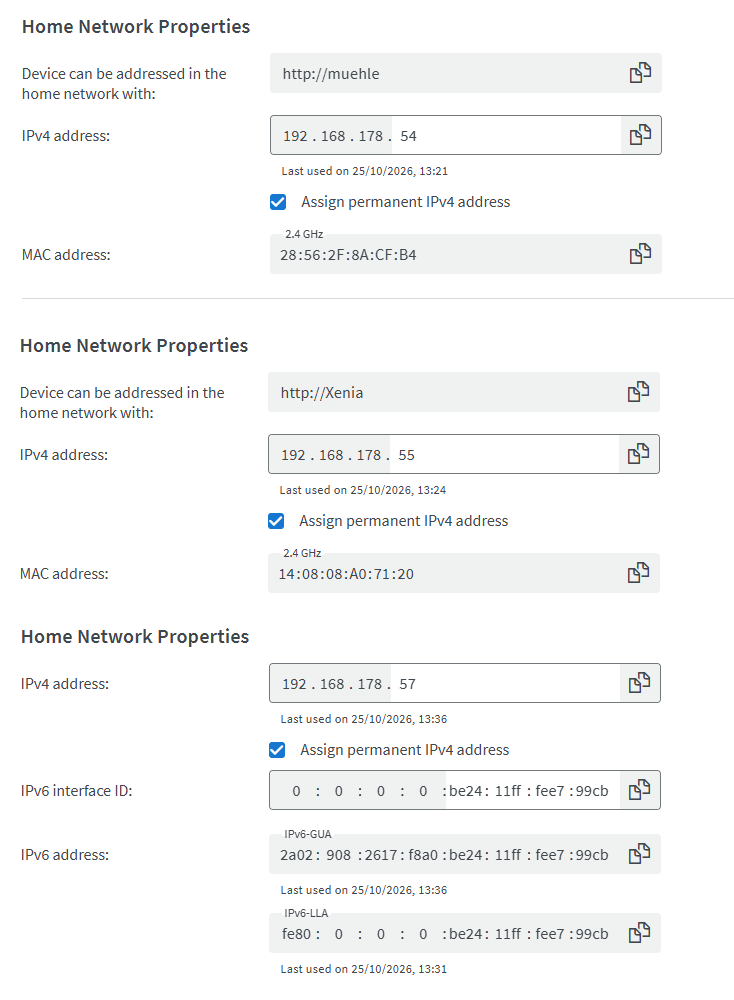

*Bild 4. Feste Adresse im Router. Die Oberfläche ist je nach Router anders. Ablegen als `docs/bilder/linux-docker/04-router-reservierung.png`.*

Optional, vor dem Skript: System aktualisieren. `install.sh` holt sich, was es zum Start braucht, auch ohne diesen Schritt. Erscheint ein lila Fenster (*Pending kernel upgrade* / Dienste neu starten), mit der Tabulatortaste auf Ok und Enter bestätigen.

```bash
sudo apt update
sudo apt full-upgrade -y
```

## 4. Xenios mit dem Skript

Ein Befehl installiert Docker, falls es fehlt, legt `/home/test/xenios` an, schreibt die Umgebung, startet den Server und richtet den Update-Dienst ein. Der Benutzer aus der Installation darf `sudo`. Das Passwort fragt das Skript ab. Auf Debian und Ubuntu dasselbe Skript wie auf dem Raspberry Pi (64-Bit, arm64 und amd64).

```bash
curl -fsSL https://raw.githubusercontent.com/TimS1998/Xenios/main/install.sh | sh
```

Das dauert einige Minuten. Am Ende steht die Zeile **Im Browser**. Die Adresse dort beginnt mit **`https://`**, zum Beispiel `https://192.168.178.57:8443`. Genau so in den Browser übernehmen, `https://` vorn lassen. `192.168.178.57:8443` ohne `https://` bleibt leer („didn't send any data“). Darunter steht der **Einrichtungscode** (`AB12-CD34`). Der Code gilt bis zur Einrichtung oder bis zum nächsten Neustart.

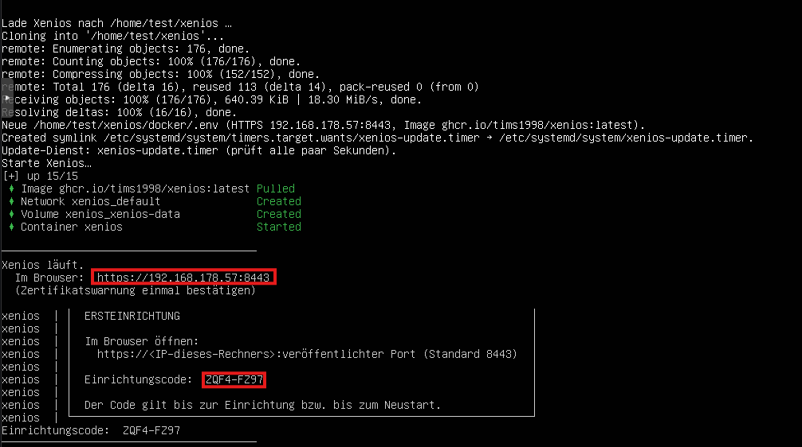

*Bild 7. Ausgabe des Skripts. Im echten Bild den Code abdecken. Ablegen als `docs/bilder/linux-docker/07-einrichtungscode.png`.*

Das Skript gibt den Pfad aus, zum Beispiel `/home/test/xenios/docker/.env`. Diesen Pfad nehmen. Eine vorhandene `.env` bleibt beim nächsten Lauf unverändert. Darin stehen die Zeitzone, die Heimnetz-Adresse vor dem Port (`192.168.178.57:8443`, Docker öffnet Ports sonst an der Firewall vorbei), das Image `ghcr.io/tims1998/xenios:latest` und `XENIOS_PULL=always`.

`ls` lässt Dateien mit Punkt am Anfang weg. `nano` ist nicht installiert. Der Ordner neben `docker` heißt `docs`.

```bash
ls -a /home/test/xenios/docker
cat /home/test/xenios/docker/.env
```

Sagt `cat` „No such file or directory“, fehlt die Datei (ein frischer Klon enthält sie nicht, sie steht nicht im Git). Das Skript legt sie dann neu an:

```bash
sh /home/test/xenios/install.sh
```

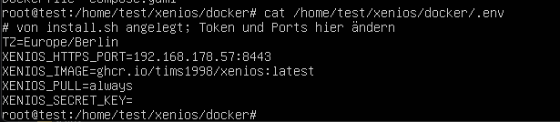

*Bild 6. `.env` nach `install.sh`. Ablegen als `docs/bilder/linux-docker/06-env.png`.*

Steht am Ende „Docker-Gruppe gilt in dieser Sitzung noch nicht“: neu anmelden (bei SSH: `exit` und erneut verbinden). Der Server läuft schon. Prüfen:

```bash
docker compose -f /home/test/xenios/docker/compose.yaml ps
systemctl is-enabled xenios-update.timer
```

STATUS nach etwa einer halben Minute: `healthy`. Der Timer steht auf `enabled`. Er lässt den Knopf *Aktualisieren* in der App das Image holen.

Dieselbe Ausgabe nennt den Zertifikats-Fingerabdruck, Zeile beginnend mit `HTTPS (Heimnetz, Zertifikat SHA-256`. Fehlt der Code:

```bash
docker compose -f /home/test/xenios/docker/compose.yaml logs xenios | grep Einrichtungscode
```

## 5. Im Browser einrichten

Auf einem anderen Gerät im selben Netz (oder auf dem Server selbst) öffnen:

```text
https://192.168.178.57:8443
```

Die Adresse ist die aus `XENIOS_HTTPS_PORT`. `http://` ohne s führt nicht auf diesen Port.

Der Browser warnt, weil das Zertifikat vom Server selbst ausgestellt ist. Das ist beim ersten Öffnen im Heimnetz so.

- Chrome und Edge: *Erweitert*, dann weiter zur Adresse.
- Firefox: *Erweitert*, dann Risiko akzeptieren und fortfahren.

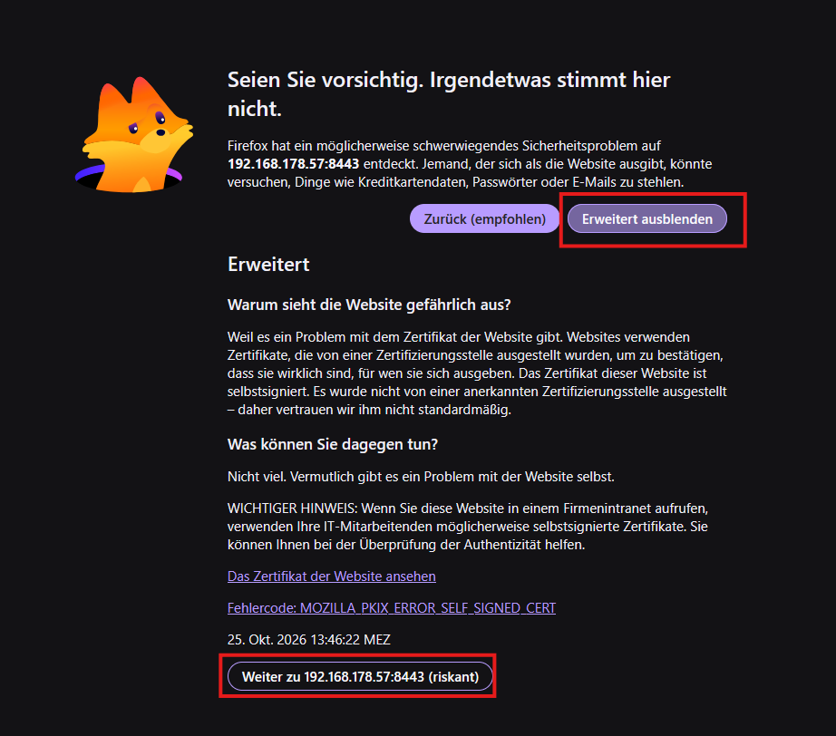

*Bild 8. Zertifikatswarnung. Ablegen als `docs/bilder/linux-docker/08-zertifikatswarnung.png`.*

Der Assistent hat sechs Schritte: Code, Passwort, Xenia, Mühle, Unterwegs, Fertig.

1. **Code.** Den Einrichtungscode aus dem Protokoll eintippen, Form `AB12-CD34`. *Weiter*.
2. **Passwort.** App-Passwort, mindestens 10 Zeichen, zweimal. Damit melden sich später alle Geräte an. Gespeichert wird nur ein Hash.
3. **Xenia.** Adresse `http://192.168.x.x`, ohne Pfad. *Verbindung testen*. Bei der neuen Maschine steht zum Beispiel „Xenia Brew-by-Sync · Firmware 4.226“. Ist die Maschine aus, geht *Weiter* trotzdem.
4. **Mühle.** Ohne E64 WS den Schalter aus. Dann fehlen Menüpunkt Mühle, Mühlen-Kacheln und Grind-by-Sync; Dosis und Mahlgrad trägt man beim Bezug selbst ein. Mit Mühle: Adresse `https://192.168.x.x` und das **Owner-Passwort** (dasselbe wie auf der Webseite der Mühle unter der Rolle Owner). *Verbindung testen*. Das Passwort liegt danach verschlüsselt in der Konfiguration. Grind-by-Sync gibt es nur zusammen mit der neuen Xenia.
5. **Unterwegs.** Optional. Die Schritte und Bilder stehen in [Abschnitt 8](#8-von-unterwegs-optional). Noch nicht fertig: *Weiter*. Eintragen und testen geht später unter *Einstellungen → Server & Sicherheit*.
6. **Fertig.** Zusammenfassung prüfen, *Einrichtung abschließen*.

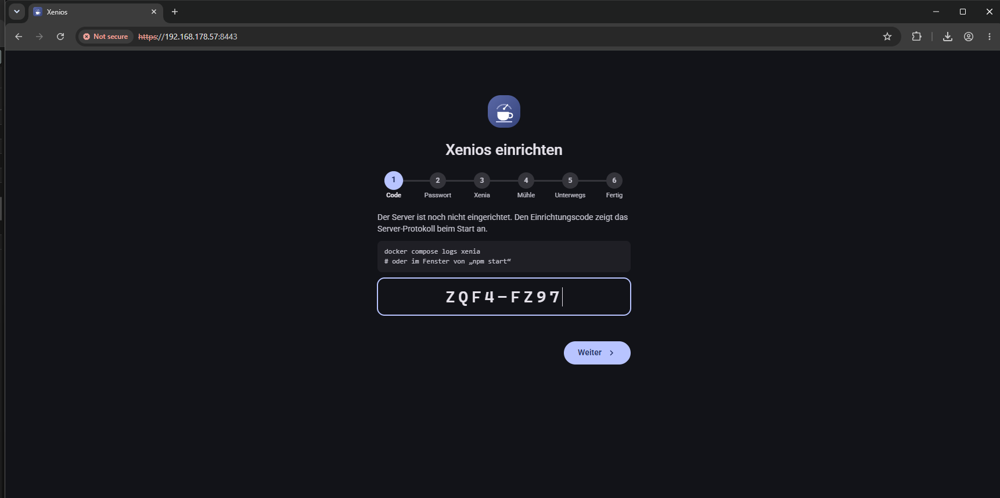

*Bild 9. Einrichtungscode im Assistenten. Ablegen als `docs/bilder/linux-docker/09-assistent-code.png`.*

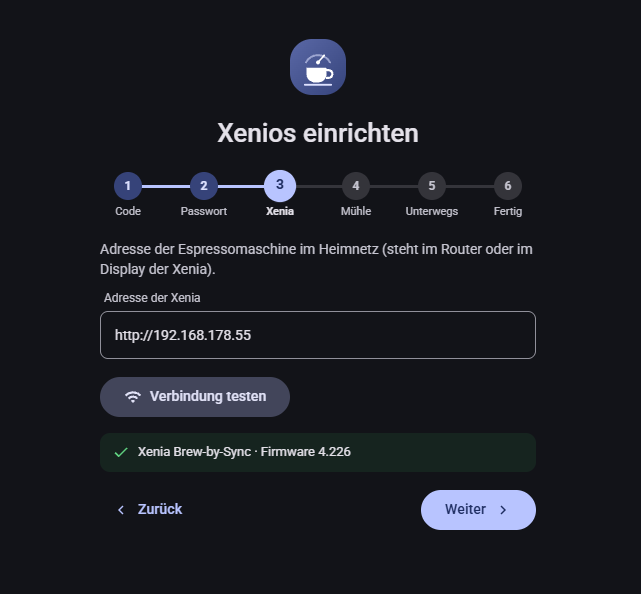

*Bild 10. Verbindungstest grün, Name und Firmware. Ablegen als `docs/bilder/linux-docker/10-assistent-xenia.png`.*

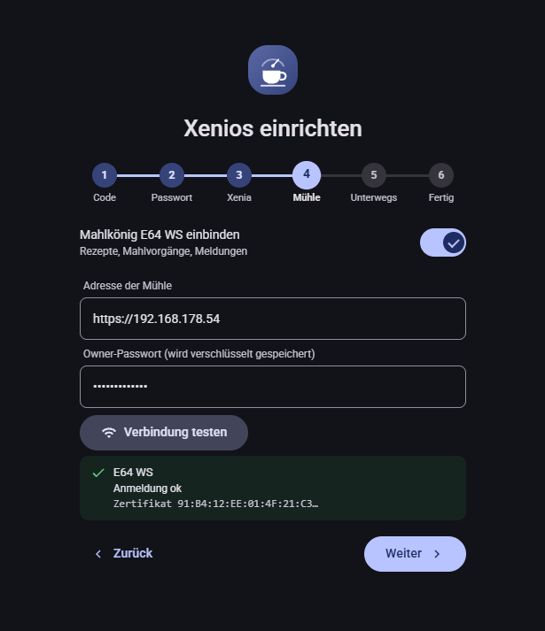

*Bild 11. Mühle mit grünem Test, oder der Schalter aus. Ablegen als `docs/bilder/linux-docker/11-assistent-muehle.png`.*

Bei der **alten Xenia** blendet Xenios Paddle, den Wochenplan der Maschine und „Uhr stellen“ aus. Ein, Aus, Eco, Dampf, Temperatur und die Skriptliste bleiben. Die Bezugszeit zählt Xenios selbst. Eco- und Ausschalt-Timer und die Schaltzeiten des Servers bleiben. Die Endpunkte stehen in [API der Xenia, alte API](API-Xenia.md#15-alte-xenia-dbl-offizielle-api).

Danach die Anmeldung mit dem App-Passwort. Die Seite im Heimnetz ist damit fertig. Installieren als App und Mitteilungen brauchen eine echte HTTPS-Adresse über Cloudflare; mit dem selbstsignierten Zertifikat lässt sich die Seite benutzen, Chrome bietet dafür keine Installation an. Siehe [Android-App](Android-App.md).

## 6. Zertifikat auf die eigene Adresse ausstellen

Im Container sieht der Server die Heimnetz-Adresse des Rechners nicht. Deshalb steht sie noch nicht im Zertifikat.

*Einstellungen → Server & Sicherheit → Weitere Namen/IPs fürs Zertifikat*: die Adresse eintragen, zum Beispiel `192.168.178.57`. Das Zertifikat wird sofort neu erzeugt. Die Browser-Warnung einmal erneut bestätigen. Wer den Fingerabdruck prüft, liest den neuen Wert so:

```bash
docker compose -f /home/test/xenios/docker/compose.yaml logs --tail 30 xenios | grep SHA-256
```


*Bild 12. Adresse im Zertifikat. Ablegen als `docs/bilder/linux-docker/12-zertifikat-namen.png`.*

## 7. Dauerbetrieb

Docker startet Xenios nach dem Hochfahren von selbst (`restart: unless-stopped`). Prüfen:

```bash
sudo reboot
```

Eine Minute warten, im Browser wieder `https://192.168.178.57:8443` öffnen und anmelden.

Ein Server-Ubuntu oder Debian schläft nicht. Läuft ausnahmsweise eine Desktop-Oberfläche auf demselben Rechner:

```bash
sudo systemctl mask sleep.target suspend.target hibernate.target hybrid-sleep.target
```

Beim Mini-PC im BIOS einschalten, dass das Gerät nach einem Stromausfall wieder startet.


*Bild 13. BIOS-Option für den Neustart nach Stromausfall. Die Bezeichnung unterscheidet sich je nach Hersteller. Ablegen als `docs/bilder/linux-docker/13-bios-stromausfall.png`.*

## 8. Von unterwegs (optional)

Ohne diesen Abschnitt ist Xenios im Heimnetz fertig. Für Handy außer Haus, installierbare Web-App und Mitteilungen braucht es eine öffentliche HTTPS-Adresse. Dafür reicht der kostenlose Cloudflare-Tarif. Im Router wird kein Port geöffnet; der Tunnel baut nur eine ausgehende Verbindung auf.

Voraussetzung: die Domain liegt bei Cloudflare und gilt dort als aktiv. Im Assistenten, Schritt **Unterwegs**, den Schalter **Cloudflare-Tunnel** einschalten. Dieselben Felder gibt es später unter *Einstellungen → Server & Sicherheit → Von unterwegs*.

1. <https://one.dash.cloudflare.com> → *Networks* → *Tunnels* → **Create a tunnel** → *Cloudflared*. Name `xenios`.

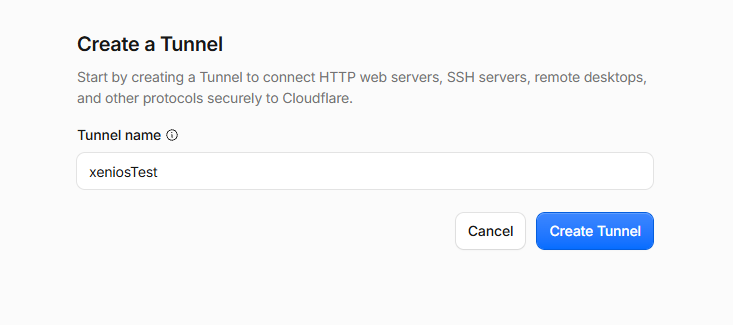

*Bild 14. Tunnel anlegen. Ablegen als `docs/bilder/linux-docker/14-cloudflare-tunnel.png`.*

2. Bei *Install and run a connector* die Zeile `sudo cloudflared service install …` kopieren. Den Befehl nicht ausführen.

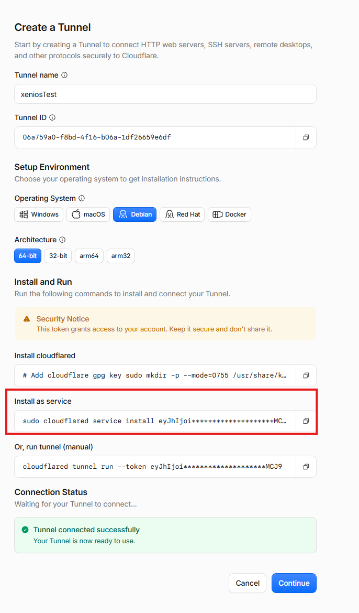

*Bild 15. Die Installationszeile, nicht ausgeführt. Ablegen als `docs/bilder/linux-docker/15-cloudflare-token.png`.*

3. Im Einrichten von Xenios, Schritt **Unterwegs**, die Zeile in *Befehl aus Cloudflare* einfügen und **Token übernehmen**. Xenios schreibt den Token und startet `cloudflared`. Nach ein paar Sekunden:

```bash
docker compose -f /home/test/xenios/docker/compose.yaml ps
```

`xenios` ist `healthy`, `cloudflared` läuft.

4. Im Tunnel einen **Public Hostname** anlegen: Subdomain zum Beispiel `xenios`, die eigene Domain, Typ **HTTP**, URL genau:

```text
http://xenios:8080
```

`localhost` oder `127.0.0.1` erreicht den Container nicht. Port 8080 ist absichtlich nur innerhalb von Docker erreichbar.

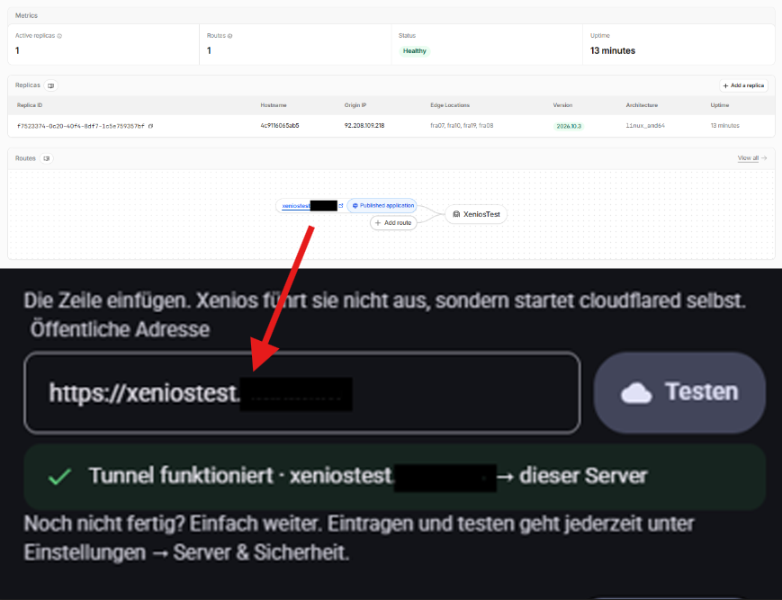

*Bild 16. Public Hostname mit `http://xenios:8080`. Ablegen als `docs/bilder/linux-docker/16-cloudflare-hostname.png`.*

5. Unter *SSL/TLS* → *Edge Certificates*: **Always Use HTTPS** und **Minimum TLS 1.2**.
6. Die öffentliche Adresse eintragen, zum Beispiel `https://xenios.deine-domain.de`, und **Testen**. Der Server ruft sich selbst über diese Adresse auf. Noch nicht fertig: *Weiter*. Eintragen und testen geht jederzeit unter *Einstellungen → Server & Sicherheit*.

Der Token in `.env` ist ein Geheimnis. Die Datei wird nicht ins Git-Repository übernommen. Rate-Limits und Länderfilter: [Einrichtung, Cloudflare](Einrichtung.md#2-cloudflare-tunnel).

## 9. Aktualisieren und sichern

Unter *Einstellungen → Server & Sicherheit* steht die installierte Version. Gibt es auf GitHub ein neueres Release, heißt der Knopf **Auf x.y.z aktualisieren**, sonst **Aktualisieren**. Er prüft GitHub in beiden Fällen.

Nach `install.sh` läuft der Dienst `xenios-update.timer`. Der Knopf holt dann Git und das Image und startet neu. Konfiguration, Sitzungen und Bezüge bleiben im Volume `xenios_xenios-data`. Die Seite kommt danach von selbst zurück.

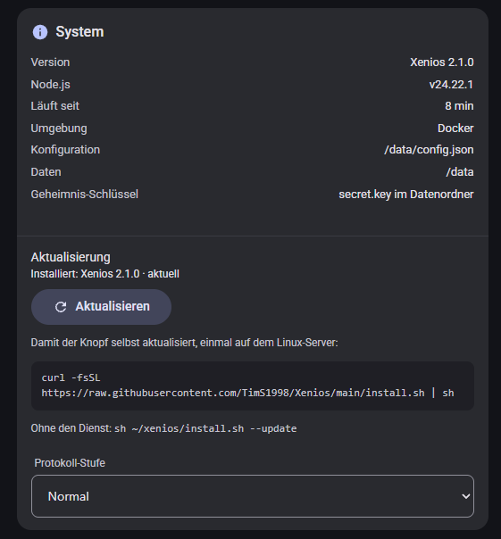

*Bild 17. Aktualisieren. Ablegen als `docs/bilder/linux-docker/17-aktualisieren.png`.*

Zeigt die Seite stattdessen den `curl`-Befehl, fehlt der Dienst. Einmal, auch wenn Xenios schon von Hand läuft:

```bash
sh /home/test/xenios/install.sh
```

Eine vorhandene `docker/.env` bleibt. Nur holen und neu starten:

```bash
sh /home/test/xenios/install.sh --update
```

Eine feste Version: in `.env` zum Beispiel `XENIOS_IMAGE=ghcr.io/tims1998/xenios:2.1.0`, danach `--update`. Auf einem Windows-PC ohne dieses Skript prüft der Knopf nur, ob eine neuere Version da ist. Geholt wird sie dort mit `git pull` und einem Neustart des Servers, siehe [Einrichtung](Einrichtung.md#1-server-installieren-windows-pc-läuft-dauerhaft).

| Was | Befehl |
|---|---|
| Läuft er? | `docker compose -f /home/test/xenios/docker/compose.yaml ps` (STATUS `healthy`) |
| Protokoll | `docker compose -f /home/test/xenios/docker/compose.yaml logs -f --tail 100 xenios` (Strg+C beendet nur die Anzeige) |
| Neu starten | `docker compose -f /home/test/xenios/docker/compose.yaml restart xenios` |
| Stoppen / starten | `docker compose -f /home/test/xenios/docker/compose.yaml stop` / `docker compose -f /home/test/xenios/docker/compose.yaml up -d` |
| Container weg, Daten bleiben | `docker compose -f /home/test/xenios/docker/compose.yaml down` |
| Alles löschen, auch die Daten | `docker compose -f /home/test/xenios/docker/compose.yaml down -v` |

In der App unter *Einstellungen → Server & Sicherheit* sichert **Sichern** Konfiguration und Bezüge als ZIP, **Einspielen** liest dieselbe Datei. Zusätzlich das ganze Volume (enthält `secret.key`, also den Schlüssel zum Mühlen-Passwort; die Datei wie ein Passwort behandeln):

```bash
docker run --rm -v xenios_xenios-data:/d -v /home/test/xenios/docker:/b alpine tar czf /b/xenios-backup.tgz -C /d .
```

Die Datei `/home/test/xenios/docker/xenios-backup.tgz` auf einen anderen Rechner kopieren. Von Windows-PowerShell:

```powershell
scp dein-benutzer@192.168.178.57:/home/test/xenios/docker/xenios-backup.tgz .
```

Wiederherstellen, auf einem neuen Rechner nachdem `install.sh` gelaufen ist und die Sicherungsdatei in `/home/test/xenios/docker/` liegt:

```bash
docker compose -f /home/test/xenios/docker/compose.yaml create xenios
docker run --rm -v xenios_xenios-data:/d -v /home/test/xenios/docker:/b alpine sh -c "tar xzf /b/xenios-backup.tgz -C /d && chown -R 1000:1000 /d"
docker compose -f /home/test/xenios/docker/compose.yaml up -d
```

`1000` ist der Benutzer `node` im Container.

## 10. Wenn etwas nicht geht

Die `docker compose`-Befehle enthalten den langen Pfad und gelten von jedem Ordner aus.

| Was passiert | Was tun |
|---|---|
| `permission denied` bei `docker` | Neu anmelden. `groups` muss `docker` enthalten. Bis dahin geht `sudo docker`. |
| `port is already allocated` | In `.env` zum Beispiel `XENIOS_HTTPS_PORT=192.168.178.57:9443`, dann `docker compose -f /home/test/xenios/docker/compose.yaml up -d`. Im Browser den neuen Port verwenden. |
| Image `denied` oder `pull access denied` | In `.env` vor `XENIOS_IMAGE` und `XENIOS_PULL` eine `#` setzen, dann `docker compose -f /home/test/xenios/docker/compose.yaml up -d`. Docker baut aus `/home/test/xenios/server`. |
| STATUS `unhealthy`, Neustarts | `docker compose -f /home/test/xenios/docker/compose.yaml logs --tail 100 xenios`. Häufig eine beschädigte `config.json` oder eine Adresse in der `.env`, die es auf diesem Rechner nicht gibt. Zum Test `XENIOS_HTTPS_PORT=8443` setzen. |
| Kein Einrichtungscode | Die Einrichtung ist schon passiert. Passwort neu setzen: `docker compose -f /home/test/xenios/docker/compose.yaml exec xenios node src/setup.js`, danach `docker compose -f /home/test/xenios/docker/compose.yaml restart xenios`. |
| Seite öffnet nicht | Adresse und Port aus der `.env`, Schema `https://`. Der Browser muss im selben Netz sein. `docker compose -f /home/test/xenios/docker/compose.yaml ps` zeigt `healthy`. |
| Knopf Aktualisieren zeigt den curl-Befehl | `systemctl is-enabled xenios-update.timer`. Steht dort nicht `enabled`: `sh /home/test/xenios/install.sh` noch einmal. |
| Maschine nicht erreichbar | Auf dem Server: `curl -m 5 http://192.168.x.x/api/v2/machine` (Adresse der Xenia). Antwortet das nicht, sieht der Server die Maschine nicht: Kabel, gleiches Netz, kein Gast-WLAN. |
| Verbindungstest will die andere Xenia | Im Assistenten oder unter *Server & Sicherheit* Neue bzw. Alte Xenia umschalten und erneut testen. |
| Falsche Uhr bei Timern | `TZ` in `.env`, danach `sh /home/test/xenios/install.sh --update`. Bei der neuen Xenia zusätzlich *Timer → Uhr stellen*. |
| Zertifikatswarnung bleibt nach Abschnitt 6 | Seite neu laden und die Warnung erneut bestätigen. Im Feld steht die Adresse ohne `https://` und ohne Port. |

## 11. Von Hand, ohne das Skript

`install.sh` überspringt Docker, wenn es schon da ist, behält eine vorhandene `.env` und richtet den Update-Dienst ein. Die Schritte einzeln stehen in [Git und Docker, Teil 3](Git-und-Docker.md#teil-3-docker). Danach einmal `sh /home/test/xenios/install.sh`, damit der Knopf in der App aktualisieren kann.


*Bild 5. Nur beim Einrichten von Hand: Docker ist da. Ablegen als `docs/bilder/linux-docker/05-docker-version.png`.*

Grind-by-Sync mit Druckprofilen gibt es mit Mühle und neuer Xenia. Anleitung: [Einrichtung, Abschnitt 6](Einrichtung.md#6-grind-by-sync-mit-druckprofilen-optional). Dafür in `/home/test/xenios/docker/compose.yaml` die Zeile `- "80:8082"` aktivieren und `docker compose -f /home/test/xenios/docker/compose.yaml up -d` ausführen.
